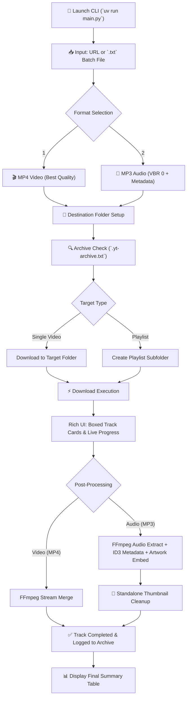

# ▶ YouTube Downloader CLI

A feature-rich, visually appealing Command Line Interface (CLI) tool for downloading YouTube videos and playlists in high quality as MP4 or MP3, powered by [`yt-dlp`](https://github.com/yt-dlp/yt-dlp) and formatted with [`rich`](https://github.com/Textualize/rich).

---

## ✨ Features

- **Video & Audio Downloads**:
  - **MP4**: Highest quality video and audio streams merged automatically.
  - **MP3**: Highest quality audio (VBR 0) with automatic FFmpeg extraction, ID3 metadata tagging, and cover art thumbnail embedding.
- **Playlist & Single Video Support**:
  - Automatically detects whether a URL points to a single video or a full playlist.
  - Saves playlist items into a dedicated subfolder named after the playlist (e.g. `C:\Users\juelb\Videos\yt-downloaded\<Playlist Name>`).
- **Batch Processing (`.txt` files)**:
  - Provide a path to a `.txt` file with one YouTube URL per line.
  - Automatically deduplicates entries in the batch file before downloading.
- **Rich Terminal UI**:
  - **Boxed Track Cards**: Displays each song inside a distinct Rich Panel containing track index (`Track X of N`), song title, artist/uploader, and status.
  - **Unified Live Progress**: Displays live downloading and post-processing progress bars inside the active track box.
  - **Pinned Overall Progress Bar**: A global playlist progress bar (`Playlist Progress: X / N tracks`) pinned to the bottom of the terminal screen.
  - **Skip Detection**: Visually marks tracks already present in the local download archive or on disk as skipped (`⏭`).
- **Download Archive**:
  - Maintains a persistent `.yt-archive.txt` log so already downloaded media is instantly skipped on future runs.
- **Clean Execution**:
  - Handles `Ctrl+C` (`KeyboardInterrupt`) gracefully without printing python stack trace errors.
  - Full UTF-8 support on Windows terminals.

---

## 🔄 Application Workflow



---

## 🛠️ Prerequisites

- **Python**: `3.10` or newer (Python `3.14` compatible)
- **Package Manager**: [`uv`](https://github.com/astral-sh/uv) (recommended) or `pip`
- **FFmpeg**: Required for audio extraction, merging streams, writing metadata, and embedding thumbnails.

---

## 🚀 Quick Start

### 1. Installation

Clone the repository and sync dependencies with `uv`:

```bash
git clone https://github.com/thecuriousjuel/youtube-downloader.git
cd youtube-downloader
uv sync
```

### 2. Running the Tool

Launch the interactive CLI:

```bash
uv run main.py
```

### 3. Usage Steps

1. **Enter Input**: Pass a YouTube video URL, playlist URL, or local `.txt` file path.
2. **Select Format**: Choose between MP4 video or MP3 audio.
3. **Confirm Destination**: Review the output directory path and confirm `[y/n]`.

---

## 📂 Output Folder Structure

Downloads are saved to your user Videos folder by default:

```
C:\Users\juelb\Videos\yt-downloaded\
├── .yt-archive.txt                                # Persistent download archive
├── Single Video Title.mp4                         # Single video download
└── Top Songs of the Decade Playlist (2010-2019)\  # Playlist subfolder
    ├── Adele - Hello.mp3
    ├── Taylor Swift - Blank Space.mp3
    └── ...
```

---

## 📜 Changelog

See the full revision history in [`changelog/CHANGELOG.md`](file:///c:/Users/juelb/Desktop/youtube-downloader/changelog/CHANGELOG.md).
